


 

 


<table>
<tr>
<td width="52%" valign="top">

 

I'm a **Full Stack Engineer** from Pakistan 🇵🇰. I started programming in 2021 and went freelance in 2022. I build whole products: the interface, the backend, the cloud underneath, and the AI features on top.

I care about software that solves a real problem for a real person. Clean, readable, no drama in production.

**What pulls me in**

- 🧠 **AI engineering** — systems that make repetitive work disappear
- ☁️ **Cloud architecture** — infrastructure that scales quietly
- ⚡ **Developer experience** — code future-me won't hate
- 🎌 **Anime** and ☕ **tea** — fuel for both

</td>
<td width="48%" align="center" valign="middle">

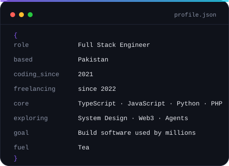

</td>
</tr>
</table>

 


<table>
<tr>
<td width="20%" align="right"><b>Frontend</b></td>
<td></td>
</tr>
<tr>
<td align="right"><b>Backend</b></td>
<td></td>
</tr>
<tr>
<td align="right"><b>Mobile</b></td>
<td></td>
</tr>
<tr>
<td align="right"><b>Cloud &amp; DevOps</b></td>
<td></td>
</tr>
<tr>
<td align="right"><b>Data</b></td>
<td></td>
</tr>
<tr>
<td align="right"><b>AI / ML</b></td>
<td></td>
</tr>
<tr>
<td align="right"><b>Tools</b></td>
<td></td>
</tr>
</table>

 


<table>
<tr>
<td width="25%">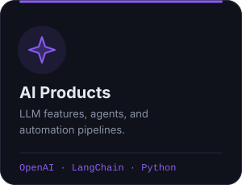</td>
<td width="25%">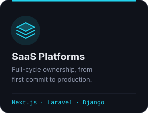</td>
<td width="25%">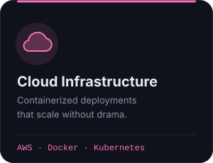</td>
<td width="25%">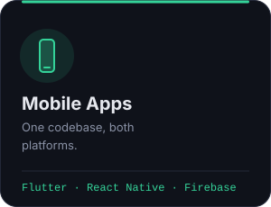</td>
</tr>
</table>

Public work lands on this profile as repositories go live.

 


<table>
<tr>
<td width="50%" align="center"></td>
<td width="50%" align="center"></td>
</tr>
</table>

 


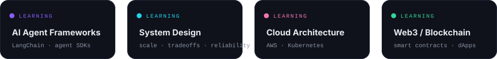

 


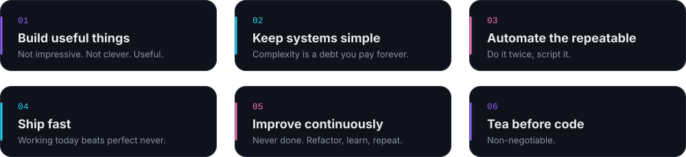

 


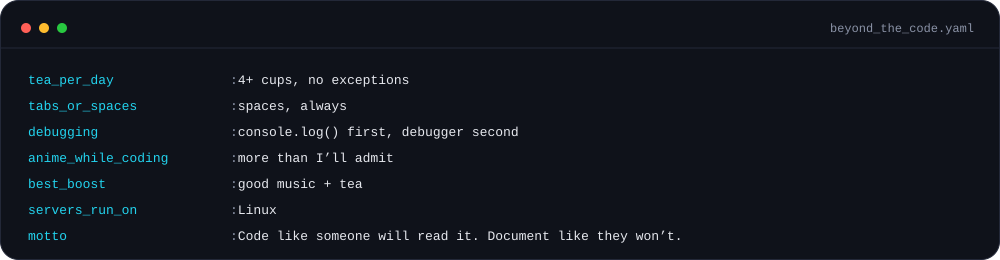

 


 

**Open to interesting projects, collaborations, and good conversations.**

 

  

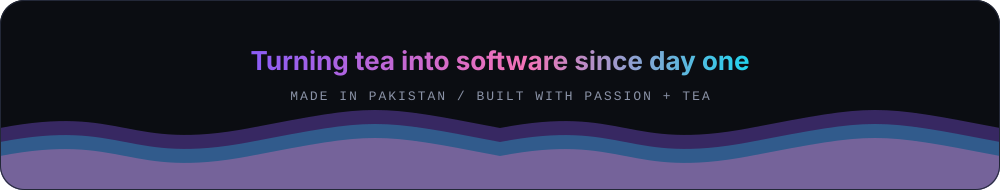

